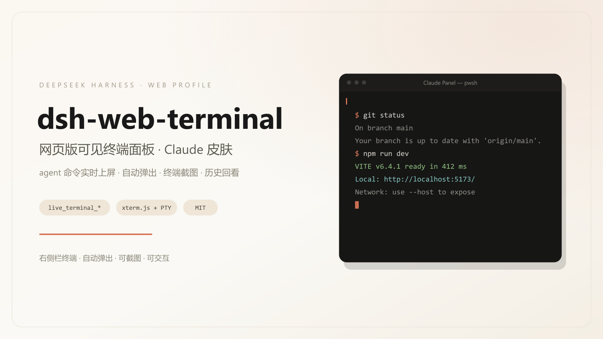
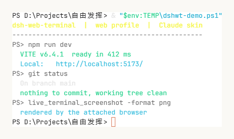

# dsh-web-terminal

Claude 风格的可见终端面板插件，面向 DeepSeek Harness（DSH）**Web profile**。
把 agent 的前台 shell 调用镜像到右侧栏终端，并向模型暴露一组 `live_terminal_*` 工具，
用于读取、搜索、等待与截屏终端。



面板内终端的实际渲染（Claude ANSI 调色板，浅色主题，`live_terminal_screenshot` PNG 输出）：



## 范围

- 仅面向 DSH **web profile**。客户端注入 `@deepseek-ai/dsh-client-ui-sidebar-right`，
  host 侧使用 `ctx.subprocess.spawnTerminal` 与 `webServer` / `connection` 服务。
- 桌面版（desktop profile）不在本仓库范围内，使用上游
  [dsh-live-terminal](https://github.com/Lancang-hzau/dsh-live-terminal)。
- 上游 fork：host 与客户端逻辑来自 dsh-live-terminal 1.3.1（MIT）。
  本仓库改动集中在视觉层（Claude 皮肤、ANSI 调色板）、包名与安装链路。

## 环境要求

| 项 | 要求 |
|---|---|
| DSH | `>= 0.2.1-alpha.3 < 0.3.0-0` |
| profile | `web`（`~/.dsh/profiles/web`） |
| Node.js | `^22.19.0 \|\| >=24.0.0` |
| 系统 | Windows 为当前测试平台；macOS / Linux 复用同一 `spawnTerminal` 路径 |

## 安装

方式一：仓库内脚本（推荐）

```powershell
git clone https://github.com/fightingFirefox/dsh-web-terminal.git
cd dsh-web-terminal
pwsh -NoProfile -File install.ps1
```

脚本行为：

1. 备份 profile 的 `package.json` 与 `cordis.patch.yml`（带时间戳后缀）
2. 复制 `lib/`、`package.json`、`cordis.patch.yml`、`LICENSE`、`NOTICE`、`icon.svg`
   到 `~/.dsh/profiles/web/node_modules/dsh-web-terminal`
3. 安装运行时依赖 `@xterm/headless`、`@xterm/addon-serialize`
   （仓库自带 `node_modules/@xterm` 时直接复制，否则执行 `npm install --omit=dev`）
4. 在 `dsh.profile.bundles` 中注册 `dsh-web-terminal`
5. 在 `cordis.patch.yml` 写入配置行（默认 `interceptShellTools: true`）

安装后必须完全退出 DSH 再启动：host 插件与 client bundle 在启动时加载。

方式二：手动安装

```powershell
$dest = "$env:USERPROFILE\.dsh\profiles\web\node_modules\dsh-web-terminal"
New-Item -ItemType Directory -Force $dest | Out-Null
Copy-Item lib, package.json, cordis.patch.yml, LICENSE, NOTICE, icon.svg $dest -Recurse
cd $dest; npm install --omit=dev
```

然后在 `~/.dsh/profiles/web/package.json` 的 `dsh.profile.bundles` 加入
`"dsh-web-terminal"`，并在 `cordis.patch.yml` 追加：

```yaml
- id: dsh-web-terminal
  name: dsh-web-terminal
  config:
    interceptShellTools: true
```

卸载：

```powershell
pwsh -NoProfile -File uninstall.ps1
```

## 安装后验证

1. 重启 DSH（`dsh web`），右侧栏出现终端标签页（kind：`web-terminal-panel`）
2. 在对话中触发一次前台 shell 命令（如「运行 `npm test`」）
   - 命令输出进入面板，右侧栏自动打开
   - 命令短于 `interceptMinVisibleMs` 时不创建标签页
3. 面板内 `+` 可新建交互终端；`Ctrl+Alt+Enter` 切换专注模式
4. 模型侧可通过 `live_terminal_list` 看到当前终端

## 行为说明

- **拦截范围**：仅 agent 的前台 `pwsh`/`bash` 调用。带 `run_in_background`
  或 `sandbox_permissions` 的调用不拦截，保持 DSH 原生语义。
- **自动打开**：一次会话内首个被拦截命令触发右侧栏打开；失败按
  `OPEN_RETRY_DELAYS`（500/1500/3000 ms）重试。
- **自动关闭**：成功 8 s、失败 30 s 后关闭；悬停暂停，`保留` 永久保留。
- **历史**：关闭的命令写入历史（默认 20 条，尾部保留 ≤64 KiB），
  `historyPersist: true` 时落盘到 `~/.dsh/dsh-web-terminal/history.json`。
- **传输**：面板数据经宿主 HTTP/SSE 通道（前缀 `/dsh-terminal-panel`）在本地
  浏览器与宿主之间传输，不访问外部服务。

## 配置

覆盖位置：`~/.dsh/profiles/web/cordis.patch.yml` 的 `dsh-web-terminal` 行。

| 键 | 默认 | 说明 |
|---|---|---|
| `interceptShellTools` | `true` | 是否拦截 agent 前台 shell 调用 |
| `interceptMinVisibleMs` | `1200` | 从 shell 就绪起计时的可见阈值；`0` 表示全部可见 |
| `autoCloseCommandDelayMs` | `8000` | 成功结束后自动关闭延迟；`-1` 永不 |
| `autoCloseFailedDelayMs` | `30000` | 失败/超时/中止后关闭延迟 |
| `autoCloseToolTerminals` | `true` | `live_terminal_run` 终端是否同样自动关闭 |
| `historySize` | `20` | 历史条数上限 |
| `historyPath` | `<home>/.dsh/dsh-web-terminal/history.json` | 历史文件路径；空串禁用 |
| `historyPersist` | `true` | 是否落盘 |
| `shellPath` | `null` | 交互 shell；`null` 表示依次探测 pwsh → powershell → cmd |
| `scrollback` | `2000` | 单终端回滚行数 |
| `maxOutputBytes` | `262144` | 单会话保留输出上限 |
| `maxSessions` | `16` | 全局终端数上限 |
| `perSessionMaxSessions` | `8` | 单 DSH 会话终端数上限 |
| `commandTimeoutMs` | `180000` | `live_terminal_run(wait:true)` 默认超时 |
| `requireSandbox` | `false` | `true` 时在非 `danger-full-access` 下拒绝接管 |
| `allowUnconfined` | `true` | 是否允许未套 DSH 沙箱的 agent 终端 |
| `portDetection` | `true` | 识别 loopback 端口并生成链接 |

## 工具接口

| 工具 | 说明 |
|---|---|
| `live_terminal_run` | 在新终端执行命令，可等待或后台返回 |
| `live_terminal_screenshot` | 截取终端屏幕：`text` / `ansi` / `png` |
| `live_terminal_send` | 向交互终端写入文本或按键（`keys`、`C-c`、`paste`） |
| `live_terminal_read` | 读取尾部 / 区间 / 全部输出；已关闭终端回退历史 |
| `live_terminal_search` | 在保留输出中按字面量或正则检索 |
| `live_terminal_wait` | 等待进程退出或输出匹配 |
| `live_terminal_expect` | 等待指定模式出现 |
| `live_terminal_status` | 返回状态、退出码、耗时、cwd、端口、沙箱标注 |
| `live_terminal_signal` | 发送 SIGINT / SIGTERM / SIGKILL / SIGHUP |
| `live_terminal_resize` | 调整 PTY 列数与行数 |
| `live_terminal_exec` | 在既有交互终端中执行命令，保留 cwd/env |
| `live_terminal_list` | 列出可见终端 |
| `live_terminal_history` | 列出最近关闭的命令 |
| `live_terminal_open` | 新建可见交互终端 |
| `live_terminal_close` | 关闭终端并终止进程树 |
| `live_terminal_rename` | 重命名终端 |
| `live_terminal_export` | 导出 text / ansi，超长时落盘返回路径 |

## 安全属性

- 面板终端与 agent 终端以当前系统用户权限运行，PTY **不套用 DSH 文件沙箱**；
  该事实会出现在面板状态栏与工具结果的 `sandbox` 字段中。
- `requireSandbox: true` 时，非 `danger-full-access` 环境不会接管命令，
  回退到内置沙箱工具。
- 升权调用（`sandbox_permissions`）与后台调用不拦截，审批流程保持不变。

## 兼容性

- DSH `0.2.1-alpha.3` 起可加载；`0.2.1-rc.2` 官方版本同样满足。
- 客户端依赖槽位 `sidebar.right.pane.tab`、服务 `sidebarRightTabs` /
  `sidebarRight`；host 依赖服务 `subprocess`、`workingDirectory`、
  `webServer`、`connection`。
- 与 `dsh-claude-style` 主题共存：面板读取 `--dsw-alias-*` 设计 token，
  浅色/深色随宿主主题切换。

## 排障

| 现象 | 检查 |
|---|---|
| 没有 `live_terminal_*` 工具 | `dsh.profile.bundles` 是否包含 `dsh-web-terminal`；宿主是否完整重启 |
| 面板标签页不出现 | `cordis.patch.yml` 是否有 `- id: dsh-web-terminal` 行；浏览器控制台是否有 client bundle 报错 |
| 命令不上屏 | `interceptShellTools` 是否为 `true`；命令是否短于 `interceptMinVisibleMs`；是否带后台/升权参数 |
| 安装被 engines 拒绝 | `dsh plugin add` 会校验版本；本仓库使用手工安装路径 |

## 构建

```powershell
npm install
npm run build       # node 调 esbuild
npm run build:cli   # 受限环境下直接调用 esbuild CLI，再执行 wrap
```

产物：

- `lib/client.js`：esbuild 打包后包在 `window.__ModuleLoader__.load({ id, factory })` 信封中
- `lib/index.js` + `lib/host/*.js`：host 半侧，Cordis 插件

目录：

```
client-src/   浏览器半侧（React + xterm，样式与主题见 styles.ts、theme.ts）
lib/host/     宿主半侧（PTY 注册表、拦截、工具、HTTP/SSE）
lib/index.js  Cordis 插件入口
tools/        构建脚本
docs/         图片与市场投稿材料
```

## 许可与来源

MIT，见 [LICENSE](LICENSE) 与 [NOTICE](NOTICE)。

- 上游：[dsh-live-terminal](https://github.com/Lancang-hzau/dsh-live-terminal)（LANCANG，MIT）
- 设计语言：参考 [dsh-claude-style](https://github.com/Nwflower/dsh-claude-style)（Nwflower，MIT）
- 终端引擎：[xterm.js](https://github.com/xtermjs/xterm.js)（MIT）
